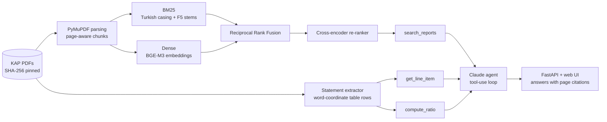

# KAP Analyst

**Agentic RAG over Turkish public-company disclosures, with page-level citations and a reproducible benchmark.**

KAP Analyst answers questions about companies listed on Borsa İstanbul using their official filings on
[KAP](https://www.kap.org.tr) (Kamuyu Aydınlatma Platformu): integrated annual reports, board activity reports
and audited financial statements. Every answer cites the PDF page it came from, and every ratio is computed
deterministically from numbers extracted from the statements, never from model arithmetic.

```text
Q: THY'nin 2024 net kâr marjı nedir?
   → compute_ratio(THYAO, net_margin, 2024)
   → 113.357 / 745.430 = 15,21 %   inputs: net_profit [THYAO s.11], revenue [THYAO s.11]
```

[](https://github.com/emrtunali/kap-analyst/actions/workflows/ci.yml)


---

## Highlights

| | |
|---|---|
| **Retrieval Hit@5** | **0.912** on 91 hand-labelled questions (up from 0.692 for plain BM25) |
| **Turkish questions Hit@5** | **0.961** (n = 76) |
| **Statement extraction** | **90 / 90** values exact (45 line items × 2 fiscal years), correct source page 45 / 45 |
| **Labels** | Every gold answer is checked mechanically against the source PDF (`kap-analyst verify-labels`) |
| **Agent** | Claude tool-use loop with 3 tools: `search_reports`, `get_line_item`, `compute_ratio` |
| **Tests** | 37 tests: unit, agent loop with a scripted fake client, API, plus integration tests on the real PDFs |

All numbers above come from [`results/RESULTS.md`](results/RESULTS.md), produced by `kap-analyst eval` on
an Apple-silicon laptop (CPU/MPS). Nothing is hand-edited.

## Why this is harder than "chat with a PDF"

1. **Turkish morphology.** *kârlılığı, kârlılık, kârlılığın* are the same word to a reader and three different
   tokens to a search engine. Python's `str.lower()` also gets Turkish wrong (`"KARI".lower()` gives `"kari"`, not
   `"karı"`). The lexical index uses Turkish casing rules and F5 prefix stemming
   (Can et al., 2008, *Information retrieval on Turkish texts*, JASIST).
2. **Numbers live in tables.** When a statement page is turned into text, the row labels and the numbers come apart.
   LLMs reading those numbers out of flattened text is the classic source of wrong-but-confident answers.
   KAP Analyst rebuilds the table rows from PDF word coordinates instead (see [Statement extraction](#statement-extraction)).
3. **Turkish number format.** `1.399.606` is one million, `82,15` has a decimal comma, `( 602.522)` is negative.
4. **Multi-column annual reports.** Sorting text by position interleaves the columns of a two-column page into
   nonsense. Switching to the PDF's own content order made three benchmark answers readable again.
5. **Bilingual users.** The filings are in Turkish, but people also ask in English.

## Architecture



| Module | What it does |
|---|---|
| [`ingest.py`](kap_analyst/ingest.py) | Download from KAP, verify SHA-256, extract page text, 160-word chunks with 40-word overlap |
| [`textnorm.py`](kap_analyst/textnorm.py) | Turkish lowercasing, accent folding, tokenisation, stopwords, F5 stemming |
| [`retrieval.py`](kap_analyst/retrieval.py) | BM25 (from scratch), dense retrieval, RRF fusion, cross-encoder re-ranking, ticker filter |
| [`statements.py`](kap_analyst/statements.py) | Rebuilds balance sheet, income statement and cash-flow rows from PDF word coordinates |
| [`ratios.py`](kap_analyst/ratios.py) | 10 ratios (margins, ROE, ROA, liquidity, leverage, growth, cash conversion) with cited inputs |
| [`agent.py`](kap_analyst/agent.py) | Claude tool-use loop, citation tracking, refusal handling, offline extractive fallback |
| [`api.py`](kap_analyst/api.py) | REST API and a single-page UI |
| [`labels.py`](kap_analyst/labels.py), [`evaluation.py`](kap_analyst/evaluation.py) | Label verification, Hit@k / MRR / nDCG |

## Dataset

Three real FY2024 filings, pinned by SHA-256 in [`data/manifest.json`](data/manifest.json). The PDFs are not
committed; `kap-analyst download` fetches them from KAP and refuses to continue if a file has changed.

| Ticker | Document | Pages |
|---|---|---|
| THYAO | Türk Hava Yolları: audited consolidated financial statements, 31 Dec 2024 | 101 |
| BIMAS | BİM: 2024 integrated annual report | 97 |
| ASELS | ASELSAN: 2024 board of directors' activity report | 93 |

**Questions.** [`data/eval/qa.jsonl`](data/eval/qa.jsonl) has 91 questions (76 Turkish, 15 English) over all three
documents, each with an exact answer string and the PDF page(s) that print it. Questions are paraphrased on
purpose ("uçulmamış biletlerden doğan yükümlülük" for *yolcu uçuş yükümlülükleri*) so that word overlap alone is
not enough. `kap-analyst verify-labels` checks that each answer string really occurs on each gold page.

**Relevance.** A retrieved page counts as relevant if it is a gold page, or, for distinctive numeric answers
(at least 5 characters, containing a digit), if it prints the same figure. Annual reports repeat headline numbers
(revenue appears in the income statement and in the revenue note), and either page answers the question.

**Statement items.** [`data/eval/statement_items.jsonl`](data/eval/statement_items.jsonl) has 45 line items with
both fiscal years (90 values), copied by hand from the THY statements, including negative values, rows whose
label wraps onto two lines, and literal Turkish labels that are not in the canonical item list.

## Results

### Retrieval ablation (page-level, 91 questions)

| Retriever | Hit@1 | Hit@3 | Hit@5 | Hit@10 | MRR@10 | nDCG@10 | ms/query |
|---|---|---|---|---|---|---|---|
| BM25 (no stemming) | 0.418 | 0.626 | 0.692 | 0.758 | 0.536 | 0.548 | 0.4 |
| BM25 + Turkish F5 stemming | 0.451 | 0.670 | 0.758 | 0.802 | 0.576 | 0.592 | 0.3 |
| Dense · multilingual-e5-small | 0.341 | 0.495 | 0.571 | 0.703 | 0.441 | 0.447 | 15.7 |
| Dense · bge-m3 | 0.527 | 0.703 | 0.791 | 0.879 | 0.639 | 0.652 | 30.8 |
| Hybrid RRF (BM25-F5 + bge-m3) | 0.549 | 0.703 | 0.780 | 0.846 | 0.647 | 0.654 | 26.9 |
| Hybrid + rerank · mMiniLMv2 | 0.615 | 0.802 | 0.890 | 0.934 | 0.722 | 0.714 | 308.2 |
| **Hybrid + rerank + company routing (default)** | **0.615** | **0.813** | **0.912** | **0.934** | **0.725** | **0.716** | 302.3 |
| Hybrid + rerank · bge-reranker-v2-m3 + routing | 0.681 | 0.890 | 0.901 | 0.923 | 0.782 | 0.770 | 2872.0 |

Hit@5 by query language:

| Retriever | English (n=15) | Turkish (n=76) |
|---|---|---|
| BM25 + F5 stemming | 0.200 | 0.868 |
| Dense · bge-m3 | 0.733 | 0.803 |
| Hybrid RRF | 0.400 | 0.855 |
| **Default pipeline** | **0.667** | **0.961** |

### What the numbers say

- **Turkish stemming is nearly free accuracy.** F5 prefix stemming lifts BM25 Hit@5 from 0.692 to 0.758 at
  essentially zero cost.
- **The embedding model matters more than the method.** A small multilingual model (e5-small) does *worse* than
  BM25 on Turkish financial text; BGE-M3 does better and is the only first-stage retriever that handles English
  questions over Turkish documents (0.733 vs 0.200 for BM25).
- **Fusion has a cost.** RRF adds BM25's noise to cross-lingual queries (English Hit@5 falls from 0.733 to 0.400),
  while it helps Turkish ones. The cross-encoder recovers most of it.
- **Re-ranking gives the biggest single gain:** Hit@1 from 0.549 to 0.615, Hit@5 from 0.780 to 0.890.
- **Precision vs. latency.** The larger `bge-reranker-v2-m3` has the best Hit@1 (0.681) and MRR (0.782), but it is
  about 10× slower on CPU (≈3 s per query). The default keeps the fast re-ranker and lets the agent read top-5.
- **Company routing** (restricting the search when the question names a company) adds +0.022 Hit@5.

**Error analysis.** The default pipeline misses 8 of 91 questions in the top 5:
- 5 are English questions over Turkish text.
- 2 are table pages (THY's cost-of-sales breakdown and the cash-flow statement). Text extraction lists the row
  labels first and the numbers after them, so a chunk no longer says "fuel = 201.778". This is exactly why figures
  from the audited statements go through the structured extractor below and not through text retrieval.
- 1 is a vocabulary gap: the question asks about *özel marka* share of *ciro*; the report says *kendi markalı
  ürünlerin net satışlara oranı*.

### Statement extraction

| | Result |
|---|---|
| Values exactly right | **90 / 90** (45 items × FY2024 and FY2023) |
| Correct source page | **45 / 45** |
| Covers | balance sheet, income statement, cash flow; negatives in parentheses; labels wrapping onto two lines |

How it works: find the statement pages by title, read the period columns from the right edge of the
`2024` / `2023` header tokens, group words into visual rows by vertical overlap (bold totals sit about 3 pt lower
than their labels, so comparing centres fails), then split each row into label, note reference and values by
x-position. Wrapped labels are stitched to the row that carries the values.

### Ratios computed from the extracted values (THY, FY2024)

| Ratio | Value | Formula |
|---|---|---|
| Gross margin | 19.17 % | Gross profit / Revenue |
| Operating margin | 10.78 % | Operating profit / Revenue |
| Net margin | 15.21 % | Net profit / Revenue |
| ROE | 19.94 % | Net profit attributable to parent / average parent equity |
| ROA | 9.26 % | Net profit / average total assets |
| Current ratio | 1.007 | Current assets / Current liabilities |
| Liabilities / Equity | 1.058 | (Current + non-current liabilities) / Total equity |
| Revenue growth | 47.79 % | Revenue 2024 / Revenue 2023 − 1 (nominal TL) |
| Capex / Revenue | 5.90 % | Purchases of PP&E and intangibles / Revenue |
| Cash conversion | 1.196 | Operating cash flow / Net profit |

The integration tests recompute several of these by hand from the printed figures
(e.g. 113.357 / 745.430 for the net margin).

## The agent

`Analyst` runs a manual tool-use loop on the Claude API (default model `claude-opus-5-5`, set
`KAP_LLM_MODEL` to change it). The system prompt requires a citation in the form `[TICKER s.<page>]` for every
figure and forbids arithmetic outside `compute_ratio`.

| Tool | Returns |
|---|---|
| `search_reports(query, ticker?, k?)` | Passages with `doc_id`, `ticker`, `page` |
| `get_line_item(ticker, item, period)` | One statement value in million TL, with its page and the exact row label |
| `compute_ratio(ticker, ratio, period)` | The value, the formula and every input with its page |

Engineering details:
- Tool errors go back to the model as `is_error` tool results, so it can recover (e.g. asking for a statement
  item of a company whose statements are not indexed).
- Requests opt into server-side refusal fallbacks (`fallbacks="default"`), and a `refusal` stop reason is handled
  explicitly.
- Token usage is accumulated across turns, and the citations are collected from tool results, not parsed from
  the model's text.
- **Without an API key** the app still works: it falls back to an extractive mode that returns the top cited
  passages.

The agent loop is tested with a scripted fake client (tool round-trip, error propagation, refusal, request
parameters), so CI needs no API key. **Not done yet:** an end-to-end evaluation of generated answers
(LLM-as-judge on the 91 questions). The harness is ready for it, but it needs an API key and budget.

## Quickstart

```bash
git clone https://github.com/emrtunali/kap-analyst && cd kap-analyst
python -m venv .venv && source .venv/bin/activate
pip install -e ".[ml,dev]"

kap-analyst download        # fetch the 3 PDFs from KAP, verify SHA-256
kap-analyst verify-labels   # 91/91 QA labels verified against the PDFs
kap-analyst index           # chunks + BGE-M3 embeddings (≈2 min on a laptop)
kap-analyst eval            # writes results/RESULTS.md (add --fast to skip the slow re-ranker)

kap-analyst ask "BİM 2024'te kaç yeni mağaza açtı?"   # extractive mode without a key
export ANTHROPIC_API_KEY=...                             # enables the agent
kap-analyst serve                                        # http://127.0.0.1:8000
```

Docker (downloads the PDFs and builds the index on first start, keeps them in a volume):

```bash
docker build -t kap-analyst .
docker run -p 8000:8000 -e ANTHROPIC_API_KEY -v kap-data:/app/data kap-analyst
```

### REST API

| Method | Path | Description |
|---|---|---|
| `POST` | `/api/ask` | `{"question": "...", "mode": "auto" \| "agent" \| "extractive"}` |
| `POST` | `/api/search` | `{"query": "...", "ticker": "THYAO", "k": 5}` |
| `GET` | `/api/statements/{ticker}/{item}?period=2024` | One line item with its page |
| `GET` | `/api/ratios/{ticker}?period=2024` | All ratios with formulas and cited inputs |
| `GET` | `/api/documents` | Indexed filings |

## Testing

```bash
pytest -q        # 37 tests
ruff check .
```

- Unit tests: Turkish casing and stemming, Turkish number parsing, BM25, chunking.
- Statement extraction on a synthetic PDF generated in the test (KAP-style layout, a negative in parentheses,
  a wrapped label), so it runs in CI without the real filings.
- Agent loop and API with a scripted fake Claude client.
- Integration tests on the real PDFs (skipped unless downloaded): checksums, all 91 labels, 90/90 extraction, and
  ratios checked against hand calculation.

CI runs lint and tests on Python 3.11 and 3.13, a job that downloads the real filings from KAP and re-verifies
the labels and extraction, and a Docker build.

## Limitations and next steps

- **Small corpus.** 3 filings and 91 questions, labelled by one person. The numbers are useful for comparing
  pipeline variants, not as a general claim about Turkish financial QA.
- **Extractor layout.** The statement extractor is tested on THY's audited-statement layout. Other auditors'
  layouts may need new title patterns. The 100 % result is on one document.
- **Generated answers are not scored yet.** Next: LLM-as-judge for correctness and citation faithfulness on the
  91 questions.
- **Tables in retrieval.** Index table rows as "label: value" text, produced by the extractor, to fix the misses
  described in the error analysis.
- **More filings.** Add more companies and quarters, and a KAP crawler with incremental indexing (pgvector).

## License

MIT. The filings belong to their issuers and are fetched from KAP at run time; they are not redistributed here.
